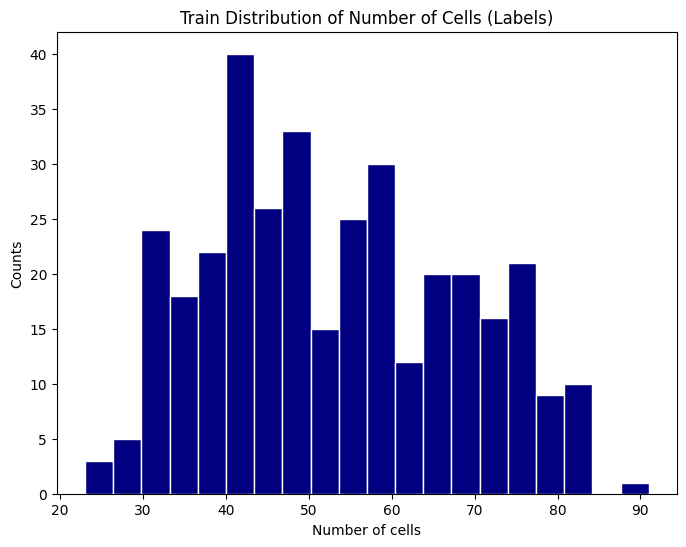
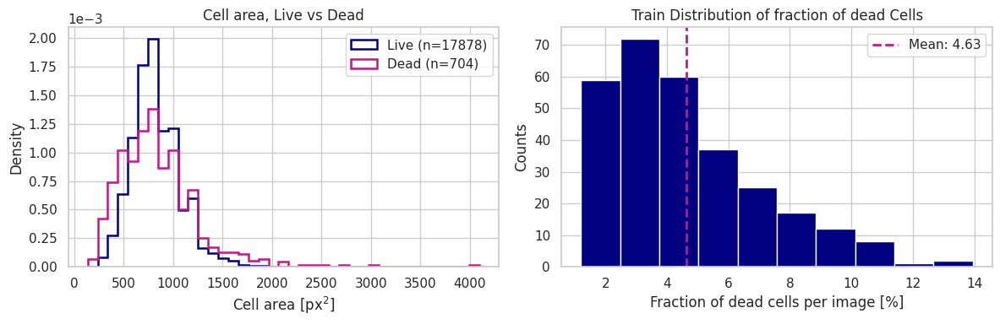
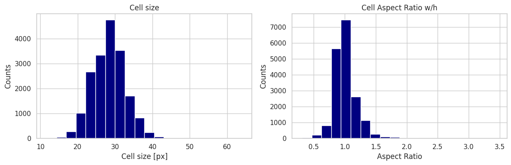
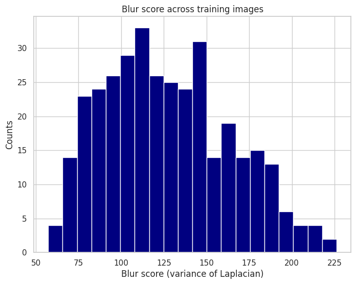
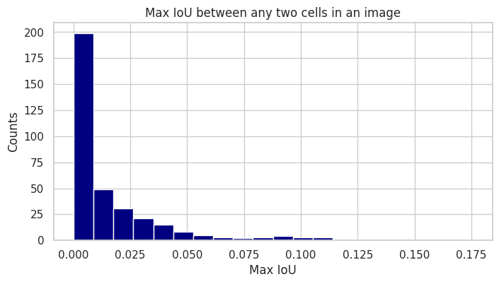
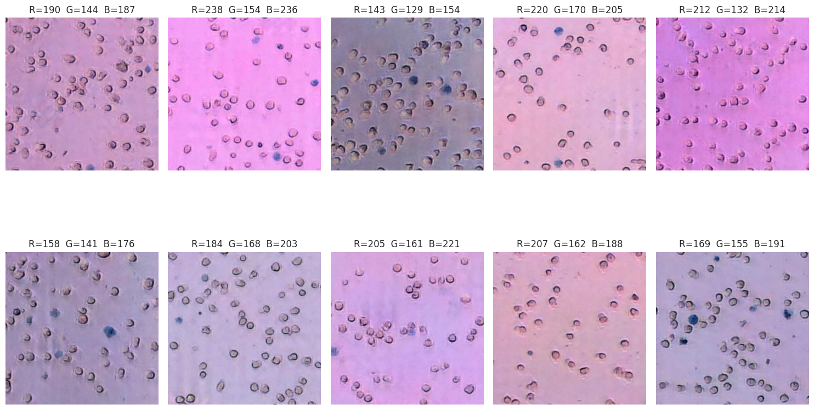

# Exploratory Data Analysis

> **Note 01** · EDA · Notebook: [`01_eda_overview.ipynb`](../notebooks/01_eda_overview.ipynb) · [All notes](README.md)

A summary of the team's EDA notebook: what the training images and labels look like, and what that means for the models. The dataset itself, its download and the shared split are described in [`00_data.md`](00_data.md).

**Scope.** The notebook loads Version 1 of a team Roboflow project in COCO format and analyses its **train folder only: 350 images and 18,582 boxes**. It uses Roboflow's own train/valid/test split (350 / 100 / 50 images), not the shared [`splits.csv`](../splits/splits.csv) that the models use, so the numbers below describe 70% of the 500 images. They are not exact figures for any of our model splits.

## Key findings

| Question | Finding | What it means for modeling |
|---|---|---|
| Image format | All 640×640 JPEGs, no missing values | No resizing or cleaning needed |
| Cells per image | Mean 53.1 ± 14.9, median 52, range 23–91 | A moderate, fairly narrow count range. Nothing very dense |
| Live vs Dead | 17,878 Live vs 704 Dead boxes (3.8%). On average 4.6% of an image's cells are Dead (about 1–14%) | Counting **total** cells is the main task. Live/Dead classification would be heavily imbalanced |
| Cell size and shape | √area mostly 20–40 px (peak near 29 px). Width/height ratio is close to 1 | Cells are small, round and of similar size, so a single detector scale should work |
| Overlap | The largest box IoU in each image is usually below 0.025 and never above about 0.12 | Cells barely touch. **This dataset does not test the dense or overlapping case** |
| Image quality (blur) | Variance of the Laplacian spreads from about 58 to 225, with no separate group of blurry images | Blur varies smoothly. A separate dataset is needed to test strong blur |
| Colour | Backgrounds range from bright pink to purple to grey (mean R from about 143 to 238) | Colour shifts between acquisition sessions, which is a reason to test on unseen sessions and to try colour augmentation or grayscale input ([`03a`](03a_rgb_grayscale_results.md)) |

## Figures

All figures come from the notebook's outputs.

**Cells per image.** Counts spread from the 20s to about 90, with most images between 30 and 80.

**Live vs Dead.** Left: Dead cells have a similar area to Live cells, with a slightly wider spread. Right: Dead cells are a small fraction of every image (mean 4.6%).

**Cell size and shape.** Box side length (√area) and width/height ratio. Cells are small, round and similar in size.

**Blur.** Variance of the Laplacian; lower means blurrier. The notebook also shows the blurriest and sharpest images.

**Overlap.** The largest IoU between any two boxes in each image. Nearly all images have essentially no overlap.

**Colour range.** Ten images picked to be as far apart as possible in mean colour. The titles give each image's mean RGB. Dead cells are the blue-stained ones.

## Takeaways

1. The images are clean and uniform (one size, no missing labels), so preprocessing can stay minimal.
2. The main challenges in this dataset are **colour and session differences** and **pale, low-contrast cells** (the main failure in [`02_baseline_results.md`](02_baseline_results.md)), not density or overlap.
3. Dense, overlapping and strongly blurred cells are missing here. Testing those needs the candidate datasets in [`project.md`](project.md), such as the synthetic cell dataset that [`05a_model_application.ipynb`](../notebooks/05a_model_application.ipynb) applies the trained model to.
4. Live and Dead are very imbalanced, so the models count total cells first.
