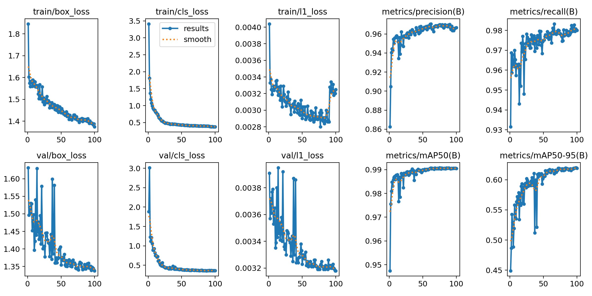
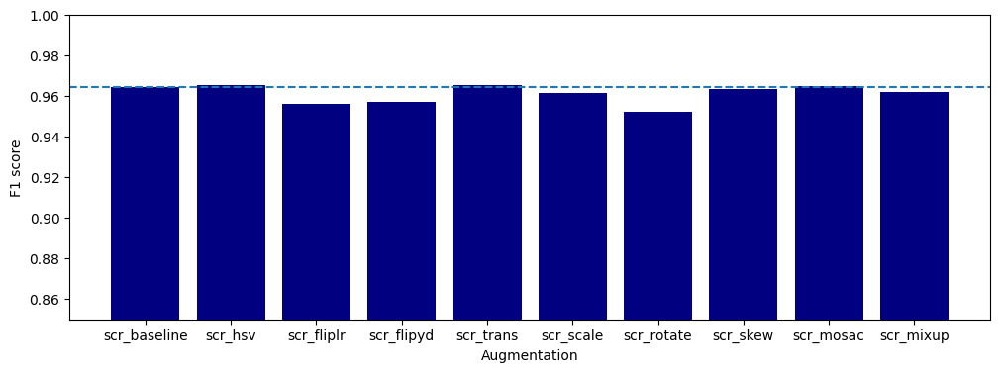

# Our Model: Training YOLO26n and Choosing Augmentations

> **Note 03** · YOLO26n training and augmentation · Notebooks: [`03_initial_model_train.ipynb`](../notebooks/03_initial_model_train.ipynb), [`03b_augmentation_exploration.ipynb`](../notebooks/03b_augmentation_exploration.ipynb) · [All notes](README.md)

Our own model is a YOLO26n object detector, trained on our labelled boxes. It finds every cell, and the count is the number of boxes. This note covers how it is trained and which training augmentations help. How well it counts, compared with the baseline, is in [`04_yolo_performance.md`](04_yolo_performance.md). A related experiment on RGB vs grayscale input is in [`03a_rgb_grayscale_results.md`](03a_rgb_grayscale_results.md).

## Training recipe (notebook 03)

1. **Data:** Version 1 of the team's Roboflow project in YOLO format, using Roboflow's own train/valid/test folders (350 / 100 / 50 images).
2. **Model:** starts from `yolo26n.pt`, the smallest YOLO26 model (2.4 million weights), which Ultralytics pre-trained on everyday photos (COCO). Training it further on our cells is called *fine-tuning*.
3. **Training:** 100 epochs at 640 px with `single_cls=True`, so Live and Dead are merged into one "cell" class. All other settings are Ultralytics defaults, including its built-in augmentation.
4. **Checkpoint:** Ultralytics keeps the epoch with the best validation score (`best.pt`).

**Run:** Colab, Tesla T4 GPU, Ultralytics 8.4.202. Training took 0.20 h (about 12 minutes).

### Validation results (100 images, 5,372 cells)

| Metric | Value | Plain meaning |
|---|---|---|
| Precision | 0.966 | 97% of the boxes it draws are real cells |
| Recall | 0.981 | It finds 98% of the labelled cells |
| mAP50 | 0.991 | Detection quality when a box only needs to overlap a labelled box by half (IoU ≥ 0.5) |
| mAP50-95 | 0.620 | The same, averaged over stricter overlap rules (IoU 0.5 to 0.95). Lower because box edges have to match closely |
| Speed | 20.9 ms per image | Inference on the T4 GPU |

**Reading the curves.**
- Top row: training losses (lower is better) and validation precision and recall. Bottom row: validation losses, mAP50 and mAP50-95.
- Validation losses fall together with the training losses, so there is no sign of overfitting.
- mAP50 levels off at about 0.99 by epoch 30. mAP50-95 keeps rising slowly until about epoch 70 and then levels off at 0.62.
- The step in the training `l1_loss` around epoch 90 most likely comes from Ultralytics turning off mosaic augmentation for the last 10 epochs (its default). The validation curves don't change at that point.

These are detection scores on Roboflow's validation folder. The count error on the shared test split, the KPI we compare models on, is in [note 04](04_yolo_performance.md).

## Which augmentations help? (notebook 03b)

*Augmentation* means training on randomly changed copies of the images (recoloured, flipped, shifted and so on), so the model learns cells rather than specific pixels. Notebook 03b switches **all** augmentations off, then turns on **one at a time** and compares each run with the no-augmentation run.

**Screening setup:** a quick, cheap schedule: 25 epochs on half of the training images (`fraction=0.5`), AdamW with learning rate 0.001, batch 16, seed 0. Each run is scored on the validation folder.

| Augmentation | Setting | mAP50 | mAP50-95 | Precision | Recall | F1 |
|---|---|---|---|---|---|---|
| **None (reference)** | all off | 0.985 | 0.575 | 0.959 | 0.969 | 0.964 |
| Colour (HSV) | `hsv_h=0.015, hsv_s=0.7, hsv_v=0.4` | 0.986 | 0.587 | 0.960 | 0.970 | **0.965** |
| Translate | `translate=0.1` | **0.988** | **0.601** | 0.958 | **0.972** | **0.965** |
| Scale | `scale=0.5` | 0.987 | 0.600 | 0.952 | 0.970 | 0.961 |
| Mosaic | `mosaic=1.0`, off for the last 10 epochs | 0.987 | 0.597 | **0.961** | 0.968 | **0.965** |
| Shear and perspective | `shear=5, perspective=0.0005` | 0.987 | 0.575 | 0.955 | 0.972 | 0.963 |
| Mixup | `mixup=0.2` | 0.984 | 0.575 | 0.958 | 0.966 | 0.962 |
| Flip left-right | `fliplr=0.5` | 0.980 | 0.540 | 0.952 | 0.960 | 0.956 |
| Flip up-down | `flipud=0.5` | 0.983 | 0.552 | 0.956 | 0.958 | 0.957 |
| Rotate | `degrees=90` | 0.981 | 0.548 | 0.949 | 0.956 | 0.952 |

*F1 per augmentation. The dashed line is the no-augmentation reference.*

**What this shows.**
- **Colour, translate, scale and mosaic help box placement:** mAP50-95 rises from 0.575 to about 0.59–0.60. Colour changes also match what the EDA found: image colour shifts between sessions ([`01_eda.md`](01_eda.md)).
- **Flips and rotation slightly hurt** in this screen (mAP50-95 0.54–0.55, F1 about 0.95).
- **The differences are small.** F1 only ranges from 0.952 to 0.965, and each setting was run once (one seed) on half the data for 25 epochs, so differences of about 0.01 may be noise. Repeating the screen with several seeds on the full schedule is left for future exploration.
- The full model in notebook 03 uses Ultralytics' default augmentations (colour, translate, scale, left-right flip and mosaic), which are mostly the helpful ones here.
