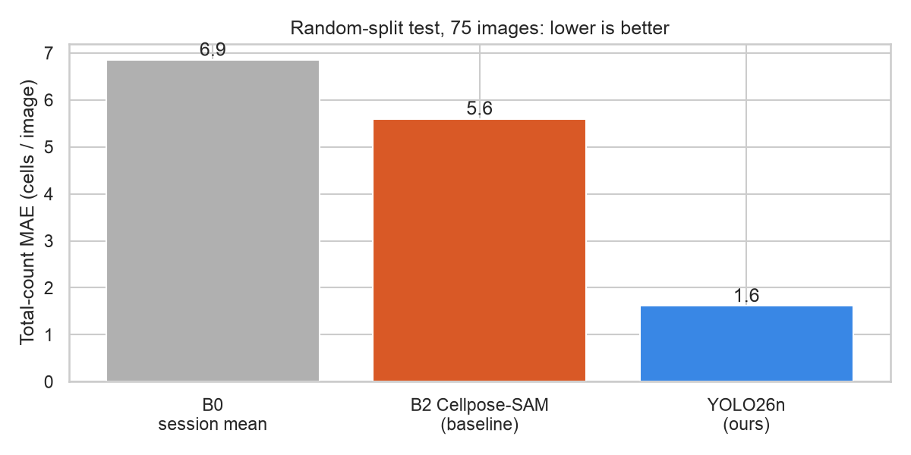
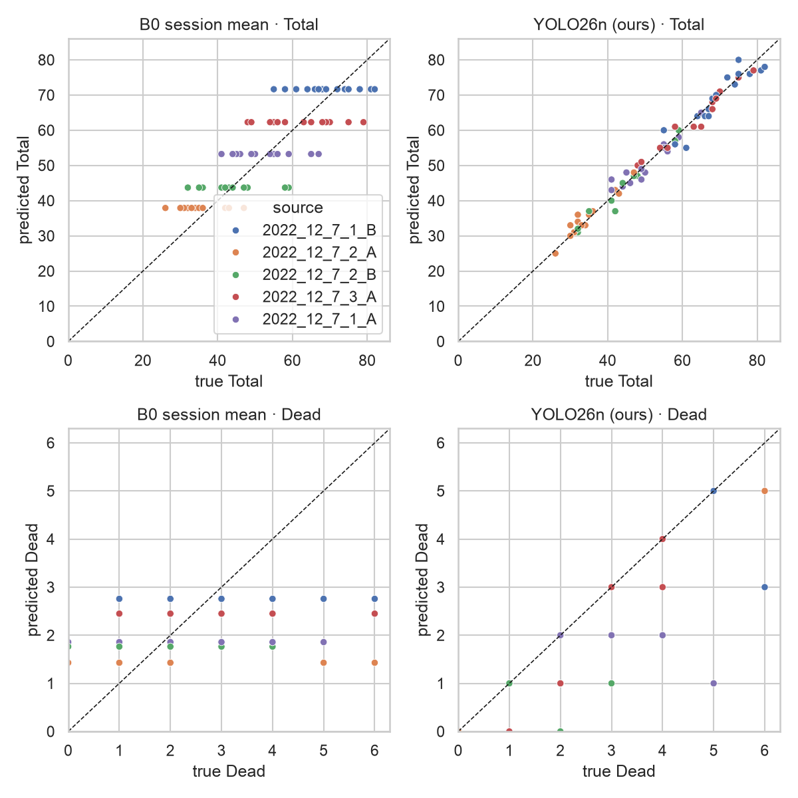
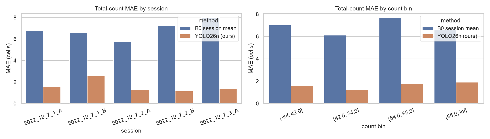
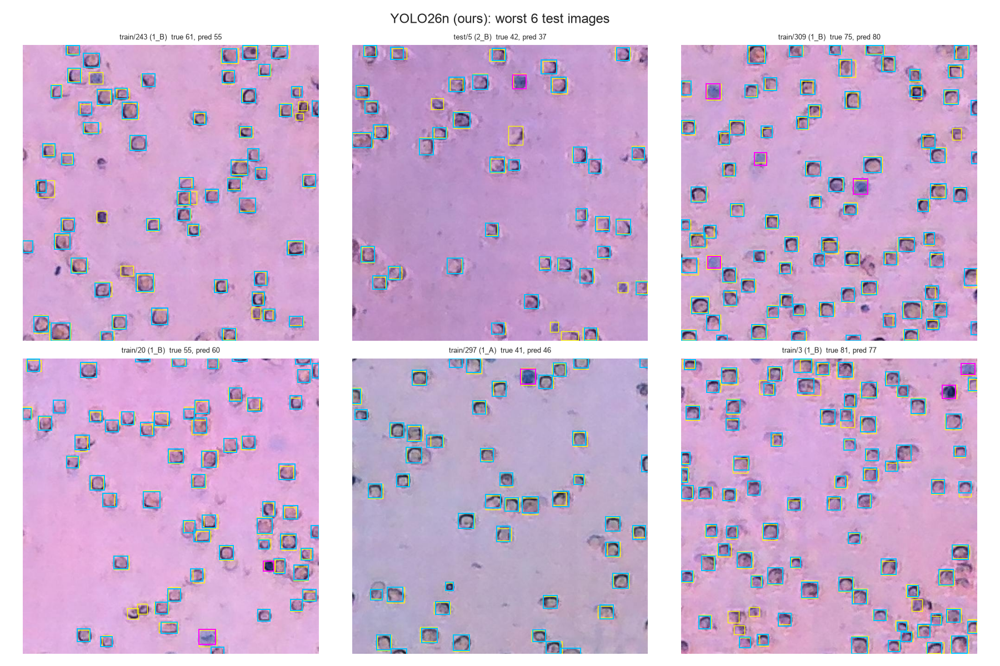

# Our Model vs the Baseline

> **Note 04** · YOLO26n performance · Notebook: [`04_yolo_performance.ipynb`](../notebooks/04_yolo_performance.ipynb) · [All notes](README.md)

**Our YOLO26n model counts cells about 3.5 times more accurately than the baseline, and about 63 times faster.** On the 75 test images it is off by 1.6 cells per image on average, against 5.6 for the baseline (tuned Cellpose-SAM, B2), and 96% of its counts are within ±10% of the true count.

The model and its training are described in [`03_yolo_training.md`](03_yolo_training.md), and the baselines in [`02_baseline_results.md`](02_baseline_results.md).

## How it was tested

- **Same test as the baselines:** the 75 test images of the shared [`splits.csv`](../splits/splits.csv), scored with the same code (`cellcount.metrics`) as notebook 02. The B2 numbers are read from notebook 02's results file.
- **Model:** YOLO26n fine-tuned on the 351 training images of the shared split, 100 epochs at 640 px, default Ultralytics settings (`cellcount.yolo.train`).
- **Confidence cut-off:** a box counts as a cell if the model's confidence is at least **0.63**. This value was chosen to minimize the count error on the 74 **validation** images, so the test images played no part in any choice.
- **Run:** trained on an Apple M5 Pro (`mps`). Re-running the notebook with the saved weights reproduces every count number below exactly. Inference time was measured on a Colab Tesla T4 GPU.

## Results (random-split test, 75 images)

| Model | Count error (MAE, cells / image) | Bias | Within ±10% | R² | Time per image |
|---|---|---|---|---|---|
| B0 session mean | 6.9 | +1.7 | 45% | 0.71 | — |
| B2 Cellpose-SAM, tuned on train (**baseline**) | 5.6 | −0.6 | 59% | 0.74 | 1.8 s |
| **YOLO26n (ours)** | **1.6** | **−0.04** | **96%** | **0.98** | **28.6 ms** |

**What the numbers mean.**
- **Count error:** our model is off by 1.6 cells per image, about 3% of a typical image's 53 cells. The baseline is off by 5.6 cells (about 11%).
- **No systematic over- or undercounting:** the bias is −0.04 cells.
- **Speed:** 28.6 ms per image on a Colab T4 GPU, against 1.8 s for Cellpose-SAM, about 63 times faster. Counting by hand takes a minute or more per image.
- **Finding cells:** precision 0.966 and recall 0.981 on the validation images at Ultralytics' default overlap rule (IoU ≥ 0.5; mAP50 0.991, mAP50–95 0.620, [note 03](03_yolo_training.md)). Cellpose-SAM reaches 0.91 and 0.90 on the test images even with the looser rule IoU ≥ 0.3, which allows for its larger boxes ([note 02](02_baseline_results.md)). Our boxes match the hand-drawn ones more closely.

*Top row: predicted vs true total count, one dot per test image, coloured by session. B0 makes one step per session, but our model sits on the diagonal for every session. Bottom row: the same for Dead cells only.*

*Count error by session (left) and by number of cells in the image (right). Our model's error stays between 1 and 2.6 cells in every session and every count range, so it doesn't depend on a particular session or on crowding.*

## Where it still makes mistakes

*The six test images with the largest count error. Yellow: labelled cells. Cyan / magenta: cells our model found as Live / Dead.*

- **The worst images are off by only 4–6 cells.** Most of the differences are faint cells, which the annotators also labelled inconsistently. At this level the model is close to the noise in the labels themselves.
- **Dead cells are the weak spot.** When it calls a cell Dead it is almost always right (precision 0.98), but it misses about a quarter of the Dead cells (recall 0.74; F1 0.85, vs 0.96 for Live). This matters only when counting Live and Dead separately, not for the total count.

## Related experiment

A separate augmentation test by a teammate ([`03a_rgb_grayscale_results.md`](03a_rgb_grayscale_results.md)) trained the same YOLO26n on the same 351 / 74 / 75 split, with its own code, a different augmentation setting and its own confidence cut-off. It reached **MAE 1.17** on the same 75 test images, so this training setup also lands far below the baseline's 5.6.
