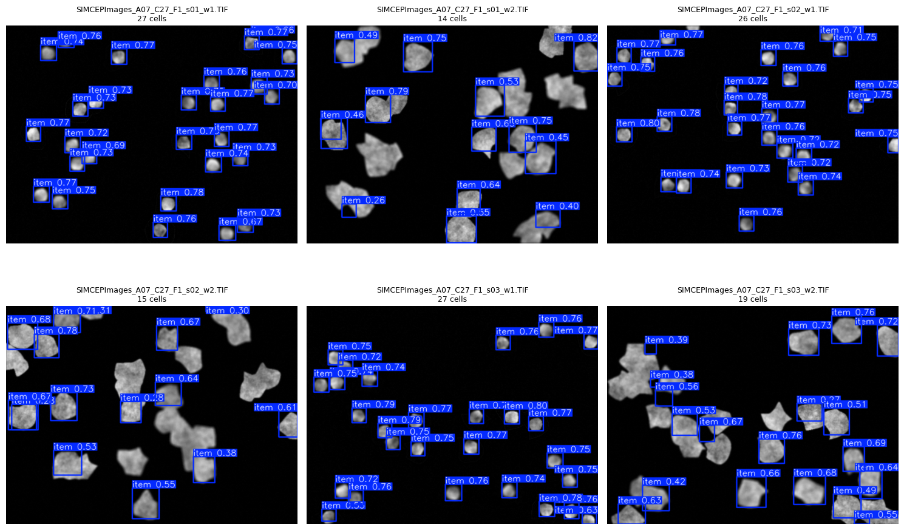

# Extra Experiments: Our Model on Other Datasets

> **Note 05** · Extra experiments · Notebooks: [`05a_model_application.ipynb`](../notebooks/05a_model_application.ipynb), [`05b_extra_experimentation.ipynb`](../notebooks/05b_extra_experimentation.ipynb) · [All notes](README.md)

Does our YOLO26n model ([`03_yolo_training.md`](03_yolo_training.md)) work on images that look nothing like its training data? Two first tests: synthetic cell images (05a), and other detection datasets: blood cells, tomatoes and eggs (05b).

## 05a · Synthetic cells (BBBC005)

### What the notebook does

1. **Trains the model** with the recipe from notebook 03 (YOLO26n, 100 epochs, 640 px, one cell class, Roboflow's split). The validation scores match note 03: precision 0.966, recall 0.981, mAP50 0.991, mAP50-95 0.620.
2. **Downloads the new dataset** from Kaggle: [Synthetic Cell Images and Masks (BBBC005 v1)](https://www.kaggle.com/datasets/vbookshelf/synthetic-cell-images-and-masks-bbbc005-v1), 19,200 simulated fluorescence images from the Broad Bioimage Benchmark Collection.
3. **Runs the model** on all 19,200 images (confidence cut-off 0.25, Ultralytics' default) and saves the images with their predicted boxes.
4. **Plots six examples**, with the number of boxes found in each title.

### Why this dataset

BBBC005 is one of the candidate datasets in [`project.md`](project.md). Our Roboflow images are sparse, pink-purple brightfield images ([`01_eda.md`](01_eda.md)). BBBC005 is different in almost every way:
- **Fluorescence:** grey cells on a black background.
- **Known counts:** each file name gives the true number of cells (`C27` means 27 cells) and how much the image is blurred (`F`, where `F1` is in focus and higher numbers are blurrier).
- **Crowding and blur:** cells touch and overlap, and many images are out of focus.

That makes it a test of the cases our own dataset lacks: dense cells, overlapping cells and blur.

### Examples

All six examples below have 27 cells (`C27`) and the sharpest focus level (`F1`). The model was never trained on images like these.

| Image type | Images | Boxes found (true: 27) |
|---|---|---|
| `w1`: small, round, well-separated cells | s01, s02, s03 | 27, 26, 27 |
| `w2`: larger, irregular cells that touch | s01, s02, s03 | 14, 15, 19 |

**What this shows.**
- On the small, round cells (`w1`), the model counts almost exactly right with high confidence (mostly 0.7–0.8), even though their colours and background are very different from our training images.
- On the larger, irregular cells (`w2`), it misses about a third to a half of the cells. Its confidence is lower (often 0.3–0.6), and it skips cells that are touching or shaped unlike our round cells.
- So the model has learned "small round blob = cell". It transfers to new images that fit that pattern, and fails on cell shapes and crowding it never saw in training.

## 05b · Other detection datasets: blood cells, tomatoes, eggs

### What the notebook does

1. **Trains the model** on our cells (YOLO26n, 100 epochs, 640 px, one class), this time from Version 2 of the team's Roboflow project.
2. **Applies that cell model, without retraining,** to three other Roboflow datasets, and reports precision, recall, mAP50 and mAP50-95 on each, with example predictions:
   - **Blood cells** (resized to fit 640 × 640), scored on its test split
   - **Tomatoes**, scored on its test split
   - **Eggs**, scored on its validation split

The question is how far "find round objects and count them" carries beyond microscope cells, from another kind of cell (blood) to everyday round objects.

### Results

The notebook is saved without its outputs, so this note describes the setup only. Running it on Colab needs the Roboflow workspace and project names as Colab secrets (`ROBOFLOW_WORKSPACE`, `ROBOFLOW_PROJECT_CELL`, `ROBOFLOW_PROJECT_BLOOD`, `ROBOFLOW_PROJECT_TOMATO`, `ROBOFLOW_PROJECT_EGG`).

## Expanding the impact

These first tests show that the counting approach is not tied to our dataset. To bring it to more labs and image types:
- **Measure it on new data with known counts.** BBBC005's file names give the true count and blur level of all 19,200 images, so the count error could be measured across blur and density.
- **Train on more kinds of images.** Adding datasets such as BBBC005 (crowded, blurred cells) or CoNIC (histology nuclei) to training would let one model count cells across microscopes, stains and cell shapes.
- **Count cell types.** The same detector can label each box, for example Live vs Dead, which gives labs viability as well as the count.
