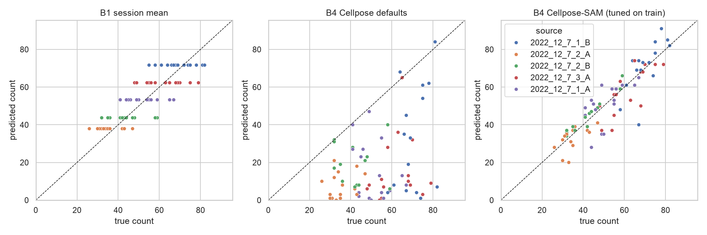
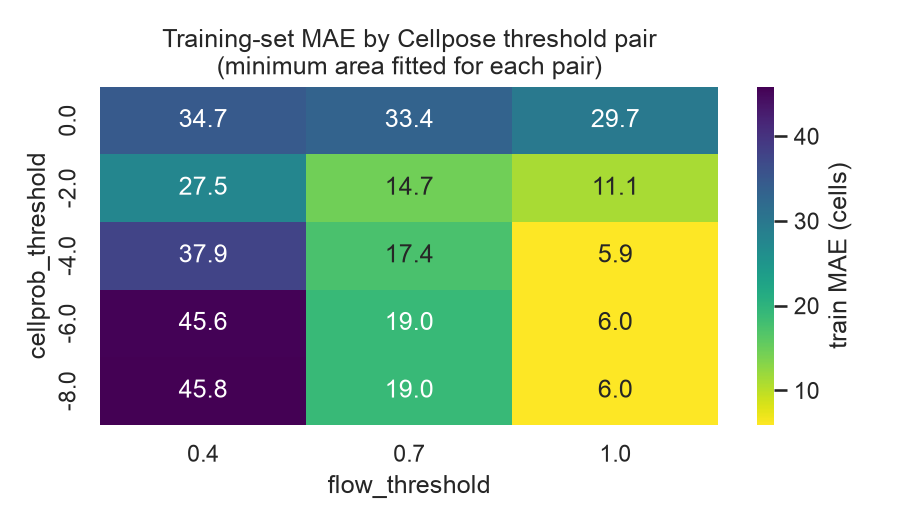
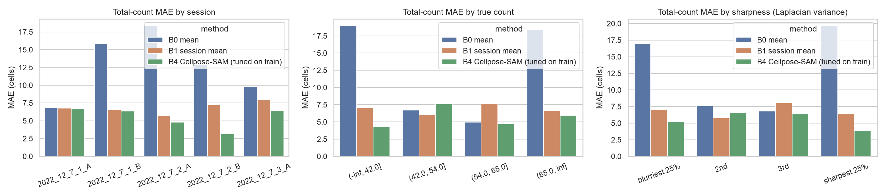
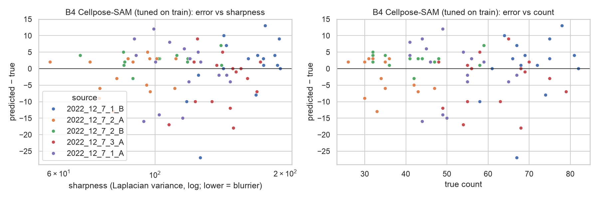
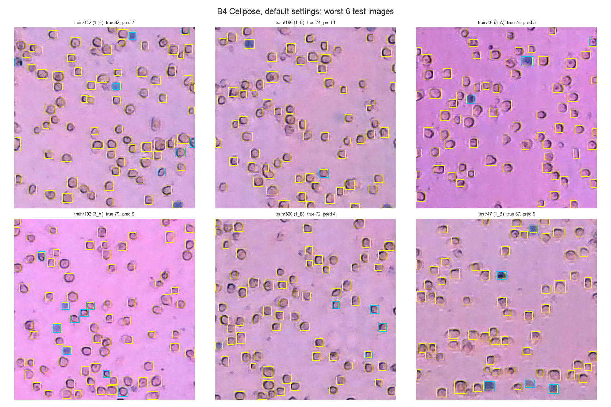
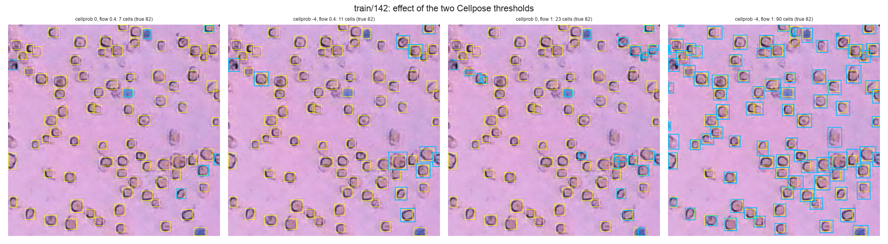
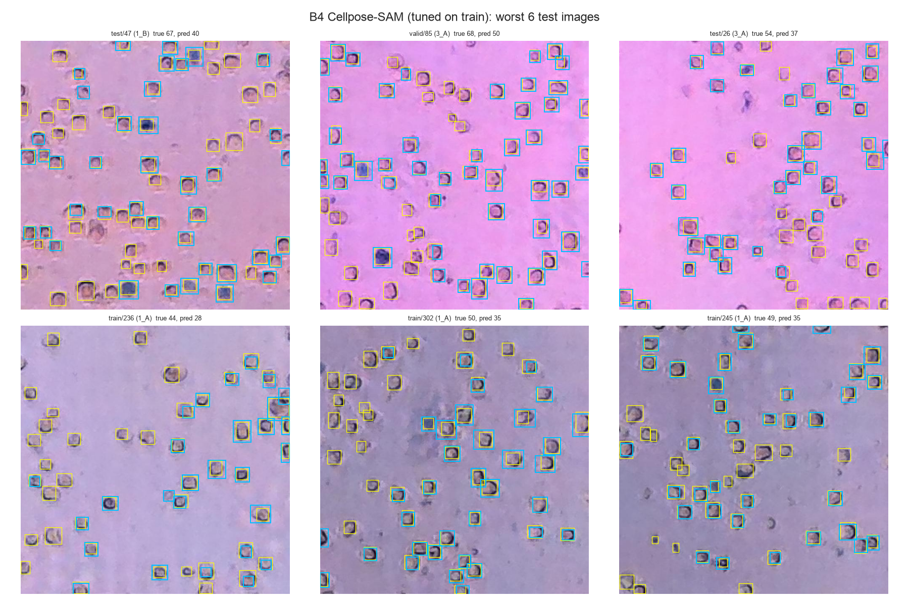

# Baseline Results

Week 4 of [`plan.md`](plan.md): how the baseline model performs. [`baseline_explained.md`](baseline_explained.md) is a plain-language walkthrough of every model and score on this page.

- **Run:** 2026-10-15 on an Apple M5 Pro laptop GPU (`mps`).
- **Code:**
  - [`notebooks/02_baseline_cellpose.ipynb`](../notebooks/02_baseline_cellpose.ipynb), which runs everything and makes the figures
  - helper modules `src/cellcount/{cellpose_zs,metrics,baselines}.py`
- **Raw numbers:** `outputs/results/baseline_cellpose.csv`.
- **Test set:** the 75 test images of `splits/splits.csv` (the random split).

> Image ids such as `train/243` keep Roboflow's original folder name. The split we actually use is the `split` column of `splits/splits.csv`, so a `train/…` id can be one of our test images.

## Task and baseline

**Task: the total number of cells in an image.** We count cells without telling Live from Dead, because most other cell datasets (the synthetic blur set, CoNIC) have no viability labels. Telling cell types apart (Live vs Dead here, or several kinds of cells in other datasets) is a later extension of the project. The colour rule for Live/Dead is kept in `cellpose_zs.py` for that.

| | Role | What it is | Uses our labels? |
|---|---|---|---|
| **B4 Cellpose-SAM** | **Baseline model.** Later models are measured against it. | A published cell-segmentation model (`cpsam_v2`) used **as downloaded**: its network is never trained on our images. It outlines every cell, and we count the outlines. | Only to choose three numbers on the training images: two mask thresholds and a minimum cell area |
| B0, B1 | Sanity references | B0 predicts the training-set mean count. B1 predicts the mean count of the image's session. | Counts only |
| B7 YOLO26n | Planned deep-learning model (not run in this round) | A published object detector, trained on our boxes on Colab | Yes: our boxes |

### Cellpose and its two post-processing parameters

Details of cellpose can be found on its [website](https://www.cellpose.org/) with the [documentation](https://cellpose.readthedocs.io/en/latest/) and in the [Cellpose-SAM preprint](https://www.biorxiv.org/content/10.1101/2025.04.28.651001).

The Cellpose network gives two maps for every pixel. Two thresholds then decide which outlines become cells. They are **post-processing parameters**: they don't change the network's weights, only how its output is read.

1. **Cell probability → `cellprob_threshold`** (Cellpose default **0**, ours **−4**)
   - The network scores how likely each pixel is to be inside a cell, on a log-odds scale: 0 means about 50% likely, and −4 about 2%.
   - Only pixels scoring above the threshold become cell pixels.
   - **Lower is more lenient:** faint, low-contrast cells, whose pixels score below 0, are kept. Too low and background starts to become "cells".
2. **Flows → `flow_threshold`** (Cellpose default **0.4**, ours **1.0**)
   - The network also predicts, for each pixel, an arrow pointing toward the centre of its cell. Following the arrows groups pixels into outlines.
   - As a quality check, Cellpose then recomputes the arrows that each finished outline *should* have and compares them with the network's arrows (mean squared error). An outline whose error is above `flow_threshold` is thrown away as badly formed. Setting it to 0 turns the check off.
   - **Higher is more lenient:** irregular or faint outlines survive. Too high and fragments and merged blobs are kept.
3. **Minimum area** (not a Cellpose setting; ours **400 px**). We add this filter after Cellpose to drop debris and small fragments. Cellpose's own minimum is 15 px.

**Default vs tuned on train**
- **Default settings** (0, 0.4, no area filter) are Cellpose exactly as shipped. They are strict, which suits the crisp, high-contrast images Cellpose was mostly trained on.
- **Tuned on train** means we tried 15 threshold pairs (`cellprob` 0, −2, −4, −6, −8 × `flow` 0.4, 0.7, 1.0). For each pair we also chose the minimum area (0–600 px) that minimizes count error. The combination with the lowest count error on the **351 training images** won: **−4, 1.0, 400 px**.
- Validation and test images played no part in the choice, and the network's weights never change. This is a grid search over post-processing parameters, not training.

## Headline

**Off-the-shelf Cellpose-SAM counts within 5.6 cells per image**, about 11% of a typical image's 53 cells, without being trained on our cells.
- Its counts are unbiased on average (−0.6 cells), and 59% of test images are within ±10%. R² is 0.74.
- It beats the session shortcut (B1: MAE 6.9, R² 0.71), which predicts each session's average count without looking at any cells.
- **Its settings matter a lot:** with Cellpose's own defaults it finds only a third of the cells (MAE 34.8).
- It misses pale, faint cells, and it takes 1.85 s per image.

## 1. Results

### Random split (75 test images)

| | Total MAE | Bias | RMSE | Relative error | Within ±10% | R² | Precision / recall (IoU ≥ 0.5) | Precision / recall (IoU ≥ 0.3) | s / image |
|---|---|---|---|---|---|---|---|---|---|
| B0 training mean | 12.7 | +1.1 | 14.9 | 28% | 24% | −0.01 | — | — | — |
| B1 session mean (shortcut) | 6.9 | +1.7 | 8.1 | 14% | 45% | 0.71 | — | — | — |
| Cellpose, default settings (0, 0.4, no area filter) | 34.8 | −34.6 | 39.8 | 66% | 9% | −6.21 | 0.95 / 0.32 | 0.96 / 0.33 | 1.85 |
| **B4 Cellpose-SAM (baseline, tuned on train)** | **5.6** | **−0.6** | **7.5** | **11%** | **59%** | **0.74** | 0.65 / 0.64 | **0.91 / 0.90** | **1.85** |

**How to read the columns**
- MAE is the mean absolute error in cells per image: the average of |predicted − true|. Overcounts and undercounts don't cancel.
- Bias is the average of predicted − true; negative means undercounting.
- RMSE is like MAE but weights large misses more. Relative error is |error| / true count, averaged over images.
- Within ±10% is the share of images whose count is within 10% of the truth.
- Precision and recall check *where* the cells are: a Cellpose cell counts as correct when its bounding box overlaps a labelled box with IoU at or above the cut-off.

**Why IoU ≥ 0.3 too:** Cellpose outlines include the halo around each cell, so its boxes are larger than the labels (median side 37 px against 29 px). That alone lowers IoU-0.5 scores. At IoU ≥ 0.3 it finds 90% of labelled cells, and 91% of what it finds are labelled cells. Its counting metrics are unaffected.

## 2. Diagnostics

**Predicted vs true counts** (test set, coloured by session). B1 predicts one number per session. Cellpose with default settings sits far below the diagonal. Tuned Cellpose follows the diagonal but scatters, with its largest misses below it.

As identified in the EDA, our datasets were taken in 5 different sessions.



**Choosing the thresholds** (training-set MAE for each pair, with the best minimum area for that pair). Cellpose's defaults (top left) miss most cells. A loose outline check (`flow_threshold = 1.0`) matters most; with it, `cellprob` between −4 and −8 makes little difference (MAE 5.93–6.02).



**Error by session, by cell count and by sharpness** (test set). Sharpness is the variance of the Laplacian (lower = blurrier), split into quarters.

| Test images | MAE | Bias |
|---|---|---|
| Session 1_A / 1_B / 2_A / 2_B / 3_A | 6.8 / 6.4 / 4.8 / 3.2 / 6.5 | −0.4 / +0.5 / −1.7 / +2.7 / −3.9 |
| True count ≤ 42 / 43–54 / 55–65 / > 65 | 4.3 / 7.6 / 4.7 / 5.9 | +0.6 / −2.1 / −0.2 / −1.0 |
| Blurriest quarter / 2nd / 3rd / sharpest quarter | 5.3 / 6.6 / 6.4 / 3.9 | −0.1 / −1.4 / −2.2 / +1.4 |





## 3. Where the baseline works and where it doesn't

### B4 with default settings: worst 6 test images



*Yellow = labelled boxes; cyan = cells Cellpose found. A yellow box alone is a missed cell.*

- With its default settings, Cellpose finds **1–9 cells where there are 67–82**. Almost everything it does find is a **dark-blue (dead) cell**. Nearly every pale live cell is rejected.
- All six come from sessions 1_B and 3_A.
- This isn't a failure to *see* the cells. The network's scores for pale cells fall below the strict defaults, as the next figure shows.

### What each threshold does



A reminder of what the two parameters do:
- **`cellprob_threshold`: which pixels count as "cell".** The network gives every pixel a score for how likely it is to be inside a cell (log-odds: 0 ≈ 50%, −4 ≈ 2%). Pixels above the threshold become cell pixels. *Lowering* it lets in fainter pixels, so pale cells get enough pixels to form an outline.
- **`flow_threshold`: which outlines are kept.** The network also gives every pixel an arrow pointing to the centre of its cell. Following the arrows groups cell pixels into outlines. Cellpose then checks each outline: it works out the arrows the outline's shape would produce and compares them with the network's arrows. If they disagree by more than the threshold (mean squared error), the outline is thrown away as badly formed. *Raising* it keeps outlines that are faint or slightly irregular.

The worst default image (82 labelled cells) under four settings, with no area filter:

| `cellprob_threshold` | `flow_threshold` | Cells found |
|---|---|---|
| 0 (default) | 0.4 (default) | 7 |
| −4 | 0.4 | 11 |
| 0 | 1.0 | 23 |
| **−4** | **1.0** | **90** |

- Neither change alone is enough. Loosening `cellprob` adds faint pixels, but the strict flow check still throws most of the resulting outlines away. Loosening `flow` keeps more outlines, but too few pixels pass the cell-probability cut-off.
- With both loosened, Cellpose finds nearly all the cells, plus some fragments (90 found vs 82 labelled). The 400 px minimum area then removes those.

### B4 tuned on train: worst 6 test images



*Yellow = labelled boxes; cyan = cells Cellpose found. A yellow box alone is a missed cell.*

**Works well:**
- **No training needed.** A published model plus three numbers chosen on training images.
- **Crisp, high-contrast cells**, in every session and count range. Session 2_B is easiest (MAE 3.2 on test).
- **Blur isn't the main problem in this set.** |Error| barely tracks sharpness (Spearman −0.12), and the blurriest quarter (5.3) does no worse than the middle two.

**Fails on:**
- **Pale, faint cells.** The six worst test images are all undercounts by 14–27 cells (e.g. `test/47`: 67 labelled, 40 found). The missed cells are the faint, low-contrast ones (yellow boxes with no cyan), especially in session 1_A.
- **Session differences.** On the test images, session 3_A is undercounted by 3.9 cells per image on average and 2_B overcounted by 2.7.
- **Default settings.** As shipped, Cellpose finds a third of the cells, mostly the dark-blue ones. The baseline depends on adapting two thresholds to our images.
- **Speed.** 1.85 s per image, because of its large ViT backbone.

### B0 / B1 (references)

- **B1 confirms the shortcut from the EDA.** Knowing only the session gives R² 0.71 on the random split.
- Cellpose clears this bar (R² 0.74 vs 0.71, MAE 5.6 vs 6.9) without any information about sessions.

## 4. Compute (KPI)

| | Download | Training | Inference |
|---|---|---|---|
| B4 Cellpose-SAM | 1.2 GB weights | none (three numbers chosen on train from cached outputs, about 30 s per threshold pair) | 1.85 s / image |

Counting a 54-cell image by hand takes on the order of a minute, so Cellpose is roughly 30× faster than a person.

## 5. Caveats

- **Fixed: threshold leak.** An earlier run picked Cellpose's thresholds (−6, 1.0) by eye on 5 sample images, two of them (`train/17`, `train/6`) in our test split. The thresholds are now chosen by grid search on training images only. The new choice (−4) is nearly tied with the old one on train (MAE 5.93 vs 6.01), and the test numbers barely moved (MAE 5.6 → 5.6, R² 0.76 → 0.74).
- **Label policy.** Some remaining errors are faint cells the annotators labelled inconsistently, so part of the error is label noise, not model error.

## 6. How the model was downloaded and run

The model is public. It needs no account or API key, and it downloads its pre-trained weights automatically the first time it is used.

### Environment

Use the project's conda environment, plus the modeling packages.

```bash
conda activate cellcount
pip install -e ".[dev,model]"   # the "model" extra = torch, torchvision, ultralytics, cellpose, scipy
```

- **Versions used:** Python 3.12, torch 2.14.1 (Apple GPU through `mps`), cellpose 4.2.1.
- **On Colab:** use a GPU runtime. torch is preinstalled, so `pip install cellpose` is enough, and the device becomes `cuda`.

### B4 Cellpose-SAM: download and run (no training)

1. **Download the pre-trained model.** The first call to `CellposeModel(pretrained_model="cpsam_v2")` downloads the published Cellpose-SAM weights (`cpsam_v2`, June 2026 release, 1.2 GB) to `~/.cellpose/models/`. See the [Cellpose docs](https://cellpose.readthedocs.io/en/latest/models.html) and the [Cellpose-SAM preprint](https://www.biorxiv.org/content/10.1101/2025.04.28.651001).
2. **Run the network once per image.**

   ```python
   import torch
   from cellpose import dynamics, models
   model = models.CellposeModel(gpu=True, device=torch.device("mps"), pretrained_model="cpsam_v2")
   _, (_, dP, cellprob), _ = model.eval(rgb_image, compute_masks=False)   # flows + cell probability
   ```

   - The network's outputs don't depend on the thresholds, so they are cached in `outputs/cache/cellpose/cpsam_v2/flows/` (float16, about 2 MB per image). All 500 images took about 20 minutes.
3. **Make masks for each threshold pair** from the cached outputs, with the same post-processing `model.eval` uses (0.05 s per image):

   ```python
   mask = dynamics.resize_and_compute_masks(dP, cellprob, niter=200, device=device,
                                            cellprob_threshold=-4.0, flow_threshold=1.0)
   ```

   - On sample images, this gives exactly the same masks as `model.eval` with the same thresholds.
4. **Choose the settings on the training images.** For each of the 15 threshold pairs, fit the minimum area (0–600 px) that minimizes total-count MAE on the training images. Keep the pair with the lowest MAE (`cellpose_zs.tune`).
5. **Count** the cells of at least 400 px in each test image.

### B0 / B1

These need no download. B0 predicts the training-set mean count for every image. B1 predicts the training mean of the image's session.

### Evaluation

- The same code (`metrics.total_count_metrics`) scores every model, per image.
- For precision and recall, each predicted box is matched to at most one labelled box with IoU at or above the cut-off.

## 7. Next steps

1. **Train the deep-learning model (YOLO26n) on Colab.** Score it on the same total-count metrics, on the random split and on leave-one-session-out.
2. **Fine-tune Cellpose-SAM on our data:** add our training images to its training set with `cellpose.train.train_seg`. It needs a mask per cell and we only have boxes, so the masks come first: keep the Cellpose outlines that match a labelled box, or prompt SAM with each box. Compare against this baseline on the same splits.
3. **Stress tests:** add blur, noise and colour shifts to the test images to measure robustness beyond our five sessions.
4. **Later extension:** tell cell types apart (Live/Dead here, other kinds of cells in other datasets).
