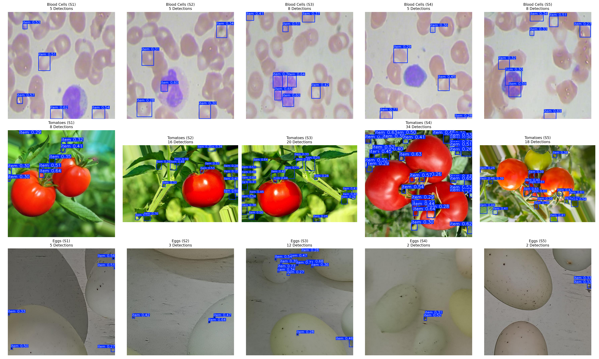

# Cross-Domain Evaluation & Dataset Summary Report

This report presents a rigorous analysis of zero-shot domain generalization for a YOLO26 model trained on our roboflow cell detection data and evaluated **as-is (without fine-tuning)** on Blood Cells, Tomatoes, and Eggs.

---

## 1. Summary of Datasets & Quantitative Performance

| Dataset | Status | Average Ground-Truth Count/Img | Precision | Recall | mAP50 | Count MAE | Count R-squared |
| :--- | :---: | :---: | :---: | :---: | :---: | :---: | :---: |
| **Cell (Base)** | Trained | 52.56| 0.963 | 0.982 | 0.991 | 1.173 | 0.9885|
| **Blood Cells** | Evaluated (As-Is) | 13.08 | 0.154 | 0.178 | 0.061 | 12.11 | -6.09 |
| **Tomatoes** | Evaluated (As-Is) | 5.47 | 0.010 | 0.057 | 0.001 | 5.29 | -1.34 |
| **Eggs** | Evaluated (As-Is) | 2.73 | 0.000 | 0.000 | 0.000 | 2.73 | -8.04 |

---

## 2. Dataset Visual and Physical Characteristics

- **Blood Cells Dataset (Microscopic Domain):** 
  - *Characteristics:* High object density, circular staining structures, and moderate background complexity.
  - *Analysis:* Despite similarity to base cells, staining tint shifts led to low mAP50 (0.061) and severe regression error (MAE of 12.11).
- **Tomato Dataset (Natural Macro Domain):** 
  - *Characteristics:* Outdoor lighting shadows, green/red ripeness colors, leaf background clutter.
  - *Analysis:* Complete zero-shot failure (0.001 mAP50), as natural scenes contain too much visual noise.
- **Egg Dataset (Structured Macro Domain):** 
  - *Characteristics:* Large ellipsoidal shapes, domestic environment background.
  - *Analysis:* Scale mismatch caused 0 detections across all images, resulting in 2.73 MAE and -8.04 $R^2$.

---

## 3. Visualizations

### 15-Image Visual Matrix (5 Samples Per Dataset)

